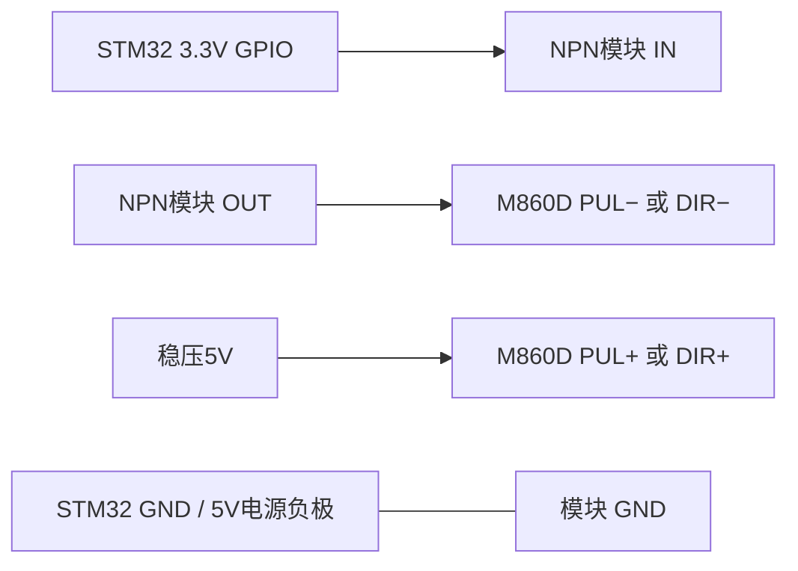

# M860D 控制信号驱动模块选型与拟接线

状态：2026-10-28 待选模块、待实施。本文是替换方案，不代表硬件已修复或已验收。

## 已确认的问题

- 当前第 5 路用于右前方向：PA2 → A5/B5 → M860D DIR+，DIR−接 GND，驱动器选 5V 档。
- 转换板空载 A5≈3.3V、B5≈4.5～4.7V；接驱动输入后电压下降。
- 对照中使用已正常的 PA3 驱动 A5，同一 B5 接右后 DIR+，DIR−接 GND。表测 A5=3.32V、B5=2.67V。
- 同时只读采样确认 GPIOA ODR=0x0C、IDR=0x460C，PA3 的高输出请求与实际引脚高一致。该静态 DIR 电平样本有效。
- 采样时控制器为 WAIT_NEUTRAL、定时器关闭，但 DIR 保留高电平；该样本不能作为当时仍在运行后退脉冲的证据。
- 用户 M860D V4.0 手册 §3.3 要求有效高电平 >3.5V；§2.1 控制输入电流 7～20mA。B5 的 2.67V 未达到要求。
- 现有接口在这个负载与接法下不能保证高电平。尚未排除 PA2 的带载差异或右前驱动输入的附加异常，不能据此单独判定驱动器损坏。

## 采购规格

建议描述给供应商：**四台 M860D 的 STEP/DIR 光耦信号接口；STM32 3.3V GPIO 控制，稳压 5V 信号电源，8 路 NPN 开集电极输出，每路需可靠灌入 7～20mA 输入电流。**

| 项目 | 要求 |
|---|---|
| 输入 | 明确支持 STM32 3.3V GPIO；模块前级与附加指示电路也应兼容 |
| 输出 | NPN 开集电极，或明确等效的低侧开漏信号驱动 |
| 数量 | 至少 8 路：4 路 PUL + 4 路 DIR |
| 带载 | 每路连续灌电流至少 20mA；是光耦信号负载，不是电机绕组 |
| 信号电压 | 允许 5V 负载，适配 M860D 的 5V 档 |
| 脉冲 | 当前使用最高 2.5kHz，建议模块明确支持至少 10kHz 的 STEP/DIR；避免用慢速滤波通道 |
| 板级资料 | 有原理图或明确端子定义，能确认 IN、OUT、GND、COM/VCC 和附加电路 |

优先候选：**ULN2803C 成品信号驱动模块**。TI 说明该芯片是 8 路 NPN 达林顿开集电极阵列，支持 3.3V 逻辑；芯片单路额定能力高于本任务的 20mA 需求。最终仍需核对成品板的输入电路及端子，不能只看芯片名称。

ULN2803A 也可作为候选，但应确认具体供应商芯片和模块在 3.3V 下的驱动能力。ULN2003 系列通常为 7 路，若用于全部四台的 PUL/DIR，需要补足第 8 路。

搜索关键词：`ULN2803 8路 NPN 开集电极 驱动模块 3.3V 输入`。

## 拟采用共阳极接法

下图以一台 M860D 为例，IN/OUT 为功能名，具体板子的针脚号待型号确认。

- 每台 M860D 的 PUL+、DIR+ 接稳压 5V；各自的负端分别接对应 NPN 输出。负端不再直接接 GND。
- STM32 GPIO 直接接新驱动模块输入，旧 A/B 转换板不串在该信号路径中。
- 模块 GND、STM32 GND、5V 信号电源负极共地。M860D 的主电源与此 5V 信号电源用途不同。
- ULN 芯片的 COM 是续流钳位公共端；成品板可能另有供电端，必须根据实际板图确认。本文不提供通用芯片引脚号，ULN2803A 与 ULN2803C 封装/引脚数量也不同。
- GPIO 为高时 NPN 导通，输出拉低，使 M860D 光耦有电流；方向逻辑按光耦有效状态核对，不仅按输出端对地电压判断是否需要软件反相。
- 5V 电源须带载稳定。验收测驱动器实际 DIR+ 与 DIR− 间的有效电压，不能仅看空载电压或对 GND 的单端电压。

建议模块通道分配（均以车体朝前为基准）：

| 通道 | STM32 | 连接模块输入；模块对应输出连接 |
|---|---|---|
| 1 | PE9 | 左前 M860D PUL− |
| 2 | PE10 | 左前 M860D DIR− |
| 3 | PE11 | 左后 M860D PUL− |
| 4 | PE12 | 左后 M860D DIR− |
| 5 | PA0 | 右前 M860D PUL− |
| 6 | PA2 | 右前 M860D DIR− |
| 7 | PA1 | 右后 M860D PUL− |
| 8 | PA3 | 右后 M860D DIR− |

## 实施与验收边界

1. 当前所有驱动器主电源保持关闭；回中、SWA 朝上后关闭控制电源。PA3→A5、B5→右后 DIR+ 是临时测试接法，标记清楚。
2. 具体新模块确定后，先核对板图与端子，再在全断电下改接；不要套用旧板 VCCA/VCCB/A/B 的针序。
3. 先只给控制系统供电、驱动主电源关闭，用真实遥控验证解锁、DIR 导通/截止与引脚带载电平；不通过调试器强制电机运动。
4. 确认 PUL/DIR 光耦有效电压、波形时序及禁用时无脉冲后，才进行架空低速试验。
5. 分别验收四轮前后方向、原地转向、行驶差速、SWA 禁用与失联停车；右前方向仍须单独验收。

## 依据

- 用户提供的《M860D V4.0 步进使用说明书 V2.0》：§2.1 输入电流、§3.2 共阳极/共阴极接法、§3.3 电平与时序。
- [TI ULN2803C 数据手册](https://www.ti.com/lit/ds/symlink/uln2803c.pdf)：3.3V 逻辑、开集电极输出及负载驱动。
- [ST ULN2803A 数据手册](https://www.st.com/resource/en/datasheet/uln2803a.pdf)：输入驱动要求与开集电极阵列。
- [Nexperia AN10441](https://assets.nexperia.com/documents/application-note/AN10441.pdf)：常见 MOS 双向电平转换依靠上拉建立高电平；仅作结构参考，不据此认定照片模块的具体器件。
